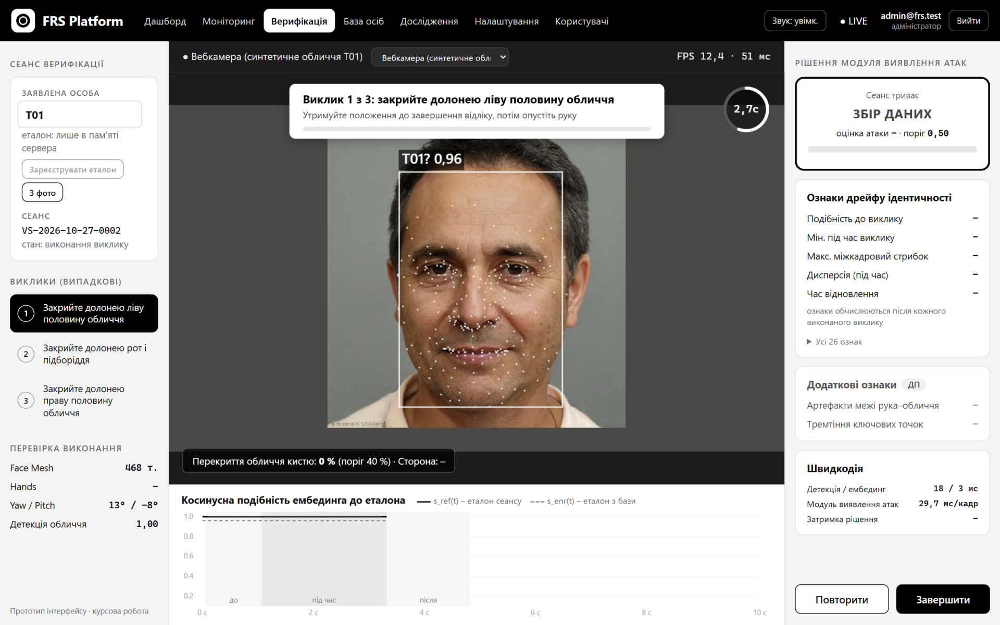
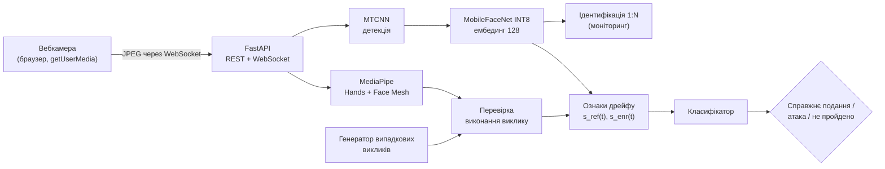
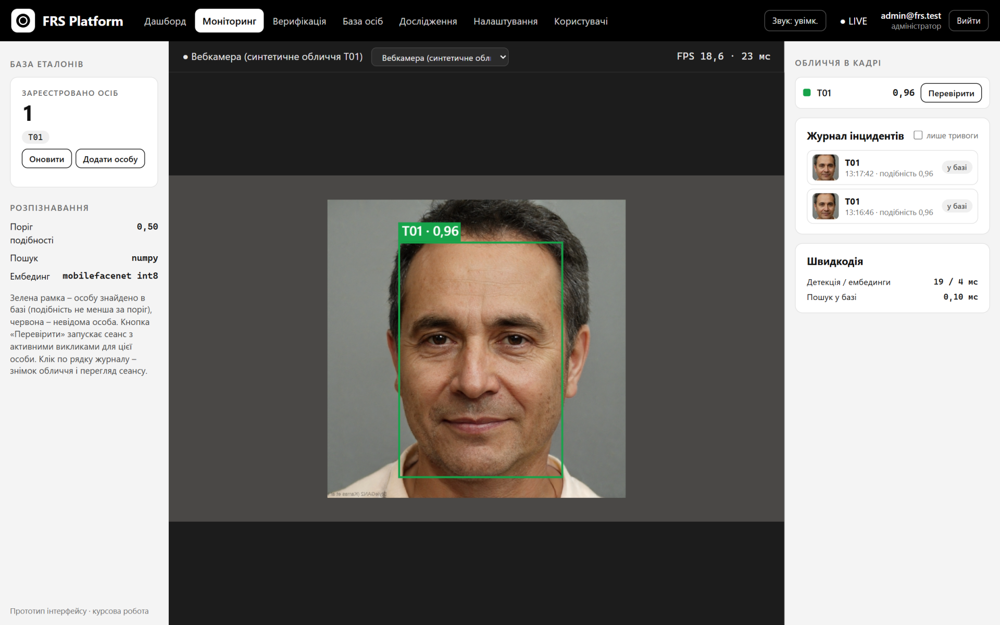
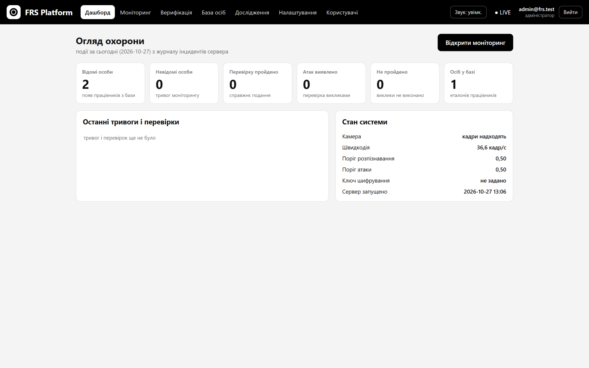
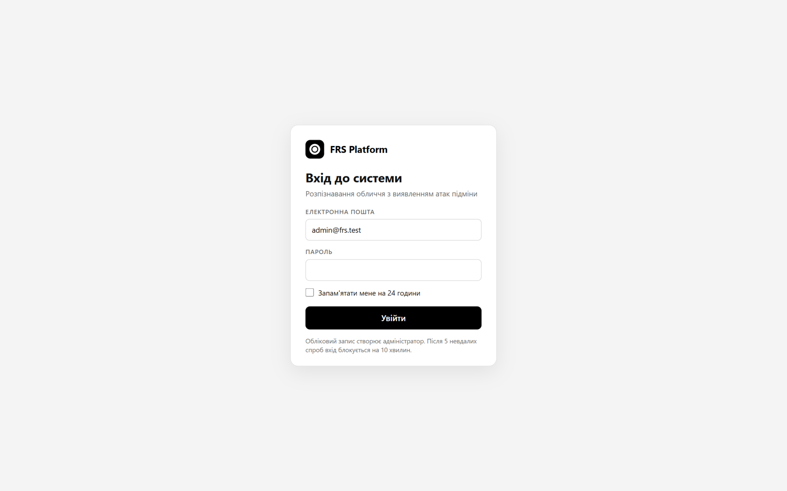
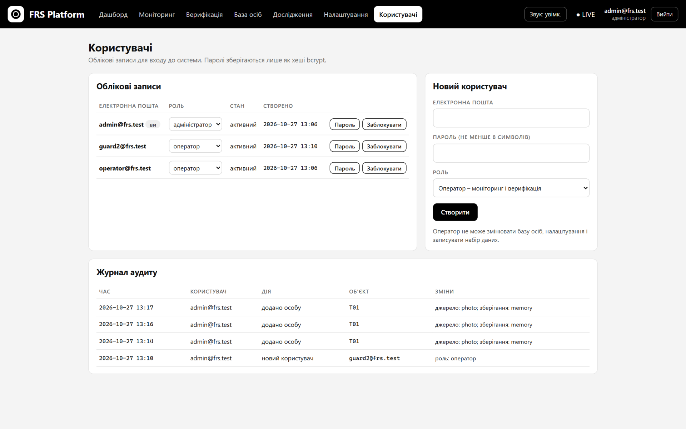

<div align="center">

# FRS PAD

**Розпізнавання обличчя у відеопотоці з виявленням атак підміни обличчя в реальному часі на основі активних викликів**

*Face recognition with real-time face-swap (deepfake) presentation attack detection using active challenges*

[](https://github.com/llllenah/frs-pad/actions/workflows/ci.yml)


[](LICENSE)



</div>

## Про проєкт

Інструменти на кшталт Deep-Live-Cam і DeepFaceLive підміняють обличчя у відеопотоці в реальному
часі, і звичайна система розпізнавання бачить «правильну» людину. FRS PAD додає до розпізнавання
перевірку **«виклик – відповідь»**: система просить людину випадковим чином закрити частину обличчя
долонею або повернути голову і стежить, як під час дії змінюється біометричний ембединг. Справжнє
обличчя під рукою «зникає» і потім відновлюється, а підмінене поводиться інакше – цю різницю ловить
класифікатор на 26 ознаках дрейфу ідентичності.

Проєкт – прототип курсової роботи (КПІ ім. Ігоря Сікорського, ФІОТ, кафедра інформатики та
програмної інженерії, 2026).

## Можливості

- **Розпізнавання** – детекція MTCNN, ембединг MobileFaceNet INT8 (128, 1,26 МБ, LFW 99,30 %),
  ідентифікація 1:N у потоці вебкамери, журнал інцидентів зі знімками і звуковими сповіщеннями.
- **Активні виклики** – 4 типи (закрити ліву / праву половину обличчя, рот і підборіддя, поворот
  голови ≥ 30°), випадковий порядок з криптографічно стійкого генератора, перевірка виконання
  через MediaPipe Hands і Face Mesh, до 2 повторів, сеанс до 20 с.
- **Виявлення атак** – ознаки дрейфу подібності до еталона сеансу і до еталона з бази у вікнах
  «до», «під час» і «після» виклику, логістична регресія, рішення з поясненням і графіком.
- **Веб-інтерфейс** – дашборд, моніторинг, верифікація, база осіб, запис набору даних, перегляд
  сеансів, налаштування, користувачі; без фреймворків, кадри йдуть на сервер через WebSocket.
- **Безпека** – вхід з JWT (24 год) і bcrypt, ролі адміністратора й оператора, блокування після
  5 невдалих спроб, журнал аудиту, AES-256-GCM для біометричних даних, HTTPS/WSS, захист від
  CSRF і DNS rebinding.
- **Дослідження** – запис набору даних зі згодою учасників, віддалений запис у браузері учасника,
  офлайн-генерування атак, навчання з перехресною перевіркою без перетину учасників, метрики
  ДСТУ ISO/IEC 30107-3 (APCER, BPCER, EER, AUC, DET- і ROC-криві).
- **Розгортання** – `docker compose up -d`, моделі завантажуються в образ автоматично.

## Як це працює



Під час кожного виклику система рахує косинусну подібність ембединга кадру до еталона, зафіксованого
на початку сеансу (`s_ref`), і до еталона особи з бази (`s_enr`). Для вікон «до», «під час» і «після»
виклику обчислюються мінімум, середнє, дисперсія, найбільший міжкадровий стрибок і час відновлення.
Оцінка сеансу – максимум оцінок його викликів; якщо виклик не виконано або обличчя не видно,
сеанс вважається непройденим, а не успішним.

## Скриншоти

| Моніторинг: ідентифікація 1:N | Дашборд |
|---|---|
|  |  |
| **Вхід до системи** | **Користувачі і журнал аудиту** |
|  |  |

На скриншотах – синтетичне обличчя, згенероване StyleGAN2, подане як фальшива камера.

## Швидкий старт

### Docker

```bash
git clone https://github.com/llllenah/frs-pad.git
cd frs-pad
cp .env.example .env        # задайте PAD_ADMIN_EMAIL, PAD_ADMIN_PASSWORD, PAD_JWT_SECRET
docker compose up -d
```

Відкрийте http://localhost:8000, увійдіть як адміністратор і дозвольте доступ до камери.
Облікові записи, журнал аудиту і зашифровані еталони зберігаються в `./data`, журнал – у `./logs`.

### Локально (Windows, Linux)

Потрібен Python 3.10–3.12.

```bash
python -m venv .venv
.venv\Scripts\activate                       # Linux: source .venv/bin/activate
pip install -r requirements.txt
python scripts/download_models.py --prebuilt # MTCNN, MobileFaceNet INT8, класифікатор
python scripts/manage_users.py add admin@example.com --role admin
python scripts/serve.py --classifier models/pad_logistic.json
```

Ключ `PAD_DATASET_KEY` (AES-256) потрібен, щоб еталони осіб зберігалися між перезапусками і щоб
працював запис набору даних: `python scripts/decrypt_recording.py --new-key`. Без нього еталони
лишаються лише в пам'яті сервера.

## Конфігурація

| Змінна | Призначення |
|---|---|
| `PAD_ADMIN_EMAIL`, `PAD_ADMIN_PASSWORD` | перший адміністратор (лише якщо облікових записів ще немає) |
| `PAD_JWT_SECRET` | ключ підпису токенів, не менше 32 байт |
| `PAD_DATASET_KEY` | ключ AES-256 для еталонів і записів набору даних |
| `LOG_LEVEL` | DEBUG, INFO, WARNING, ERROR, CRITICAL |
| `PAD_ALLOWED_HOSTS` | імена сервера для доступу з мережі |
| `PAD_SSL_CERTFILE`, `PAD_SSL_KEYFILE` | сертифікат TLS – HTTPS і WSS |

Параметри модуля (типи і кількість викликів, тривалість, пороги, моделі) – у
[`configs/pad.yaml`](configs/pad.yaml). Опис API – http://localhost:8000/docs.

## Результати

Пілотний набір: 4 учасники, 34 справжні сеанси і 34 атаки підміни обличчя, перехресна перевірка
з виключенням учасника (учасники тестової вибірки не входять до навчальної).

| Модель (рівень сеансу) | APCER | BPCER | EER | AUC |
|---|---|---|---|---|
| **Логістична регресія, 26 ознак** | **0,0 %** | **2,9 %** | **0,0 %** | **1,000** |
| Логістична регресія, лише s_ref | 48,5 % | 29,4 % | 24,2 % | 0,783 |
| Поріг на мінімумі s_ref | 57,6 % | 38,2 % | 51,5 % | 0,479 |

| Показник | Значення |
|---|---|
| Точність розпізнавання LFW (MobileFaceNet INT8) | 99,30 % ± 0,41 % |
| Конвеєр кадру 1280 × 720 на CPU (Intel Core i5-8265U, без GPU) | 20–28 кадрів/с |
| Обчислення ознак і рішення | 2–4 мс |

Набір малий, тому числа попередні; методика, абляція й обмеження – у
[docs/experiments.md](docs/experiments.md).

## Тести

```bash
python -m pytest
```

230 тестів: генератор і перевірка викликів на синтетичних ключових точках, ознаки, класифікатори
і метрики, стани сеансу, шифрування, REST і WebSocket API, вхід, ролі й аудит. Камера для них не
потрібна – замість конвеєра працює синтетичний користувач; кілька тестів моделей і FAISS
пропускаються, якщо моделей або FAISS немає.

## Структура

```
pad/                 модуль: виклики, перевірка, ознаки, класифікатори, сеанси, сервер, вхід
  web/               односторінковий інтерфейс (HTML, CSS, JavaScript)
scripts/             сервер, керування користувачами, запис і імпорт, навчання, моделі, LFW
configs/             параметри модуля і протоколи експериментів (YAML)
remote/              сторінка віддаленого запису для учасника
notebooks/           генерування атак у Google Colab
runs/                метрики пілотного набору і LFW
tests/               pytest
docs/                документація
```

## Документація

- [Веб-інтерфейс](docs/web-interface.md) – вкладки, сповіщення, перегляд сеансів, API
- [Захист інформації](docs/security.md) – вхід, ролі, журнали, HTTPS, шифрування
- [Набір даних](docs/dataset.md) – запис, віддалений запис, офлайн-атаки, шифрування
- [Навчання і оцінювання](docs/experiments.md) – метрики, LFW, швидкодія, обмеження
- [Моделі і структура коду](docs/architecture.md) – класи, джерела ваг, демонстрація без браузера

## Етика і дані

Набір даних зібрано лише за письмовою інформованою згодою учасників; учасники позначаються
псевдонімами, записи й еталони зберігаються зашифрованими і до репозиторію не входять. Цільові
обличчя для атак – обличчя учасників за згодою або синтетичні. Інструменти підміни обличчя
застосовувалися лише для перевірки власної системи.

## Ліцензія і подяки

Код – [MIT](LICENSE). Ваги моделей мають власні ліцензії: MTCNN –
[timesler/facenet-pytorch](https://github.com/timesler/facenet-pytorch) (MIT), MobileFaceNet –
[foamliu/MobileFaceNet](https://github.com/foamliu/MobileFaceNet) (Apache 2.0), YuNet і SFace –
[OpenCV Zoo](https://github.com/opencv/opencv_zoo) (Apache 2.0), MediaPipe – Apache 2.0.
Модель inswapper_128 для генерування атак у репозиторій не входить і має некомерційну ліцензію.

**Авторка:** Олена Сергієнко, група ІП-42 · керівник роботи – доц. Світлана Поперешняк.
